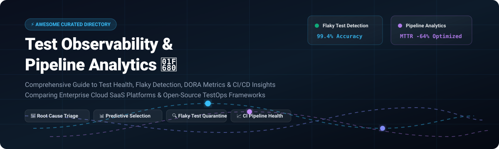

<p align="center">
  
</p>

# 🧪 Awesome Test Observability & Pipeline Analytics 📊 🚀

<p align="center">
  <a href="https://github.com/ishandutta2007/Awesome-Awesome-Awesome"></a>
  <a href="https://discord.gg/jc4xtF58Ve"></a>
  <a href="https://github.com/ishandutta2007/Awesome-Awesome-Awesome"></a>
  <a href="http://creativecommons.org/publicdomain/zero/1.0/"></a>
  <a href="https://makeapullrequest.com"></a>
  <a href="https://github.com/ishandutta2007"></a>
</p>

> 🌟 A curated guide and architectural directory to top **Test Observability** and **CI/CD Pipeline Analytics** platforms — featuring enterprise SaaS monitoring solutions, predictive test selection engines, and open-source TestOps dashboards for tracking test suite reliability, flaky test detection, build acceleration, and DORA performance metrics.  
> 
> ⭐ *Star this repository if you find it helpful!* ⭐

---

## 📋 Table of Contents 📑

- [🌐 Sector Overview & Market Dynamics](#-sector-overview--market-dynamics)
- [☁️ SaaS & Hosted Commercial Platforms](#️-saas--hosted-commercial-platforms)
- [💻 Open-Source Software & TestOps Frameworks](#-open-source-software--testops-frameworks)
- [📊 Feature & Architectural Matrix](#-feature--architectural-matrix)
- [💡 Core Architectural Concepts](#-core-architectural-concepts)
- [📈 Star History](#-star-history)
- [💖 Support & Community](#-support--community)
- [🤝 Contributing](#-contributing)
- [📄 License](#-license)

---

## 🌐 Sector Overview & Market Dynamics 📈

The global **software testing and continuous observability market** is valued at approximately **$45 Billion to $55 Billion**, with dedicated cloud-based test observability, predictive test selection, and CI/CD pipeline analytics expanding rapidly at an estimated **15% to 21% CAGR** toward **$110B+ by the early 2030s**.

The sector is **moderately fragmented**: broad enterprise observability titans (such as Datadog and Dynatrace) and comprehensive test-suite platforms (such as Tricentis and BrowserStack) capture large commercial enterprise deployments, while specialized predictive test intelligence engines (Launchable) and build cache platforms (Develocity) compete aggressively on speed optimization, leaving self-hosted and open-core TestOps frameworks (such as ReportPortal and Allure TestOps) as essential pillars for privacy-focused engineering teams.

---

## ☁️ SaaS & Hosted Commercial Platforms 🏢

Commercial cloud-hosted test analytics and CI/CD observability solutions. The table below is sorted in descending order of vendor scale (company valuation / enterprise revenue).

| 🏢 Platform | 💰 Scale (Valuation / Revenue) | 🏷️ Pricing (Starting Tier) | 🎁 Free Tier / Trial Limits | 🔍 Key Capabilities | 🎯 Best For |
|---|---|---|---|---|---|
| **[Datadog CI Visibility](https://www.datadoghq.com/product/ci-visibility/)** | **~$48.5B Market Cap** (~$3.4B ARR) | **~$8.00–$10.00 / active committer / month** (billed annually as add-on) | **14-Day Full Free Trial** (unrestricted access to CI pipeline & test tracing across all supported CI providers) | Intelligent Test Runner (ITR), early flake detection, flaky quarantine, critical path analysis | Unified full-stack observability correlating APM, cloud infrastructure, and CI/CD pipelines |
| **[Tricentis SeaLights](https://www.tricentis.com/products/test-management-analytics/sealights)** | **~$4.5B Valuation** (~$500M ARR) | **Custom Enterprise Quote** (seat & volume tiered; entry contracts typically ~$15,000–$30,000/yr) | **Guided Enterprise PoC / Pilot** (no permanent free tier; hands-on multi-week evaluation environment via sales) | Tiered Test Optimization Strategy (Conservative 100%, Moderate 80%, Aggressive 60%), periodic full runs | Risk-based predictive test minimization for large multi-repo continuous delivery pipelines |
| **[BrowserStack Test Observability](https://www.browserstack.com/test-observability)** | **~$4.0B Valuation** (~$230M ARR) | **Metered usage starting ~$0.0079 / test execution / month** (or custom bundled enterprise plan) | **Free Forever Tier** ($0 for small test suites with basic retention) + **60-min / 14-day evaluation trial** | AI-driven root cause failure categorization, flaky test auto-tagging, chronological multi-log view | Automated test triage across local, CI, and multi-browser test execution grids |
| **[Cypress Cloud Analytics](https://www.cypress.io/cloud)** | **~$255M Valuation** (~$17.8M ARR) | **$67/mo** (billed annually for Team Tier; $75/mo month-to-month) | **Free Starter Tier ($0 forever)** (includes 500 test results/mo, up to 10 user seats, 30 days retention) | Smart Orchestration, automated test parallelization, Test Replay DOM time-travel, flake analytics | Teams committed to Cypress end-to-end and component testing |
| **[Gradle Develocity](https://develocity.ai/)** | **~$160M Valuation** (~$30M–$46M ARR) | **~$700 / active developer / year** (average contract value ~$45,000/yr) | **Free Build Scan® Service** (free community scans on scans.gradle.com) + **Guided Multi-Week Enterprise Trial** | Distributed build cache, flaky test detection, build scan timeline, predictive test selection | JVM and polyglot build acceleration across Gradle, Maven, sbt, Bazel, and npm |
| **[Launchable](https://www.launchableinc.com/)** | **~$12.7M Total Funding** (Series A venture-backed) | **Pay-As-You-Go** (Mars Team tier starting ~$1,000/mo or usage-metered) | **Moon Plan ($0 Forever)** (free for 1 user, flaky test detection, test suite insights, Slack alerts) | Machine-learning Predictive Test Selection (PTS), file path relevance algorithms, log search | Minimizing pipeline execution duration by running the minimal impactful test subset |

---

## 💻 Open-Source Software & TestOps Frameworks 🐧

Self-hosted, community-driven, and open-source platforms for test reporting, metrics extraction, and pipeline observability. The table below is sorted in descending order of GitHub stars count.

| 📦 Repository & Framework | ⭐ GitHub Stars | 🧰 Tech Stack | 📜 License | 🔍 Observability Capabilities | 🎯 Best For |
|---|---|---|---|---|---|
| **[OpenTelemetry Collector](https://github.com/open-telemetry/opentelemetry-collector)** | [](https://github.com/open-telemetry/opentelemetry-collector/stargazers) | Go | Apache 2.0 | Vendor-agnostic ingestion, processing, and exporting of CI/CD spans, test execution metrics, and pipeline traces. | Standardizing pipeline telemetry across OpenTelemetry-compatible backends |
| **[Allure Report (Allure 2)](https://github.com/allure-framework/allure2)** | [](https://github.com/allure-framework/allure2/stargazers) | Java, TypeScript | Apache 2.0 | Multi-language interactive graphical test reporting with timeline charts, flaky status indicators, and defect grouping. | Universal framework-agnostic test execution reports |
| **[ReportPortal TestOps](https://github.com/reportportal/reportportal)** | [](https://github.com/reportportal/reportportal/stargazers) | Java, Go, React, PostgreSQL | Apache 2.0 | AI-driven test execution analytics, automatic failure triage, flaky test clustering, and real-time CI status dashboards. | Enterprise self-hosted central test analytics hub |
| **[Keptn](https://github.com/keptn/keptn)** | [](https://github.com/keptn/keptn/stargazers) | Go, Kubernetes | Apache 2.0 | Cloud-native continuous delivery metrics, automated SLO-based evaluation, and pipeline quality gates. | Kubernetes-native release validation and delivery analytics |
| **[Testkube](https://github.com/kubeshop/testkube)** | [](https://github.com/kubeshop/testkube/stargazers) | Go, Helm, React | MIT / Open Core | Kubernetes-native test orchestration, centralized cluster execution logs, test artifacts management, and telemetry export. | Running and observing tests natively inside Kubernetes clusters |
| **[Pytest-HTML](https://github.com/pytest-dev/pytest-html)** | [](https://github.com/pytest-dev/pytest-html/stargazers) | Python | Mozilla Public 2.0 | Clean self-contained HTML test reports with summary analytics, execution durations, filtering, and embedded failure logs. | Python test automation suites requiring lightweight zero-infra reporting |
| **[Allure Docker Service](https://github.com/fescobar/allure-docker-service)** | [](https://github.com/fescobar/allure-docker-service/stargazers) | Shell, Python, Docker | Apache 2.0 | Containerized microservice providing a REST API and auto-refresh web UI to render live historical Allure test reports. | Effortless multi-project team test reporting on Docker / Kubernetes |
| **[CTRF GitHub Test Reporter](https://github.com/ctrf-io/github-test-reporter)** | [](https://github.com/ctrf-io/github-test-reporter/stargazers) | TypeScript, Node.js | MIT | Ingests Common Test Report Format (CTRF) JSON outputs to publish rich test summaries, failed test analysis, and flaky detection directly in GitHub Actions summaries. | Native GitHub Actions workflow test visibility without external SaaS dashboards |
| **[Jenkins Warnings Next Generation](https://github.com/jenkinsci/warnings-ng-plugin)** | [](https://github.com/jenkinsci/warnings-ng-plugin/stargazers) | Java | MIT | Parses build and test log outputs across 100+ tools to render trend graphs, new versus fixed defect analysis, and quality gate evaluations. | Jenkins CI pipelines tracking test trends, code analysis, and build health |
| **[Jenkins Pipeline Stage View](https://github.com/jenkinsci/pipeline-stage-view-plugin)** | [](https://github.com/jenkinsci/pipeline-stage-view-plugin/stargazers) | Java, JavaScript | MIT | Visual breakdown of pipeline stage execution times, step failures, and historical throughput for Jenkins declarative and scripted pipelines. | Visualizing bottleneck stages and execution latency across Jenkins jobs |

---

## 📊 Feature & Architectural Matrix ⚙️

| 🛠️ Platform / Tool | 🏷️ License / Model | 🧪 Automated Flaky Detection | ⚡ Predictive Test Selection | 🚪 Automated Quality Gates | 🖥️ Self-Hosted Available | 🔗 Primary Focus |
|---|---|:---:|:---:|:---:|:---:|---|
| **Datadog CI Visibility** | Commercial SaaS | ✅ AI & Early Detection | ✅ Intelligent Test Runner | ✅ Triggers & Monitors | ❌ Cloud Only | Full-stack pipeline & infrastructure telemetry |
| **Tricentis SeaLights** | Enterprise Commercial | ✅ Test Impact Analytics | ✅ Risk-Tiered Selection | ✅ Release Quality Gates | ❌ Cloud Managed | Code-impact risk minimization |
| **BrowserStack Observability** | Commercial SaaS | ✅ Auto ML Classification | ❌ No | ✅ Alert Policies | ❌ Cloud Managed | Cross-browser test failure diagnosis |
| **Cypress Cloud** | Commercial SaaS / Freemium | ✅ Flake Rate Analytics | ❌ (Parallel only) | ✅ Spec Prioritization | ❌ Cloud Only | Cypress test suite orchestration |
| **Gradle Develocity** | Enterprise Commercial | ✅ Unstable Test Detection | ✅ Predictive Test Selection | ✅ Build Cache Policies | ✅ On-Prem & Cloud | Build system caching & test acceleration |
| **Launchable** | Freemium SaaS | ✅ Flake Diagnostics | ✅ Graph / ML Selection | ✅ Pipeline Insights | ❌ Cloud Managed | Machine learning test subsetting |
| **ReportPortal** | Open Source (Apache 2.0) | ✅ ML Auto-Analysis | ❌ No | ✅ Defect Triage Gates | ✅ Yes (Docker / K8s) | Centralized enterprise TestOps reporting |
| **Allure Report** | Open Source (Apache 2.0) | ⚠️ Visual Tagging | ❌ No | ❌ Runner Dependent | ✅ Yes (Static / Container) | Universal interactive report generation |
| **Keptn** | Open Source (Apache 2.0) | ❌ Runner Dependent | ❌ No | ✅ Native SLO Gates | ✅ Yes (Kubernetes) | Cloud-native release SLO evaluation |
| **Testkube** | Open Core (MIT) | ⚠️ Execution Retries | ❌ No | ✅ Policy Enforcement | ✅ Yes (Kubernetes) | Cluster-native test orchestration & observability |
| **CTRF Reporter** | Open Source (MIT) | ✅ Flaky Identification | ❌ No | ✅ GitHub Action Fail-Fast | ✅ Yes (Local / CI) | Lightweight native GitHub Actions summaries |

---

## 💡 Core Architectural Concepts 🧩

Modern engineering organizations implement test observability and pipeline analytics across three distinct operational layers:

```
┌────────────────────────────────────────────────────────────────────────┐
│                   1. Execution & Test Runner Layer                     │
│  (Playwright, Cypress, Selenium, JUnit, Pytest, Go Test, WebdriverIO)  │
└───────────────────────────────────┬────────────────────────────────────┘
                                    │ Test Results, Traces, JUnit XML, CTRF
                                    ▼
┌────────────────────────────────────────────────────────────────────────┐
│                2. Observability Ingestion & CI Analytics               │
│  - Intelligent Test Selection (SeaLights, Launchable, Develocity)      │
│  - Flaky Test Quarantine & Auto-Retry (Datadog, BrowserStack)          │
│  - Pipeline Tracing & DORA Metrics (OpenTelemetry, Keptn)              │
└───────────────────────────────────┬────────────────────────────────────┘
                                    │ Telemetry, Dashboards, Quality Gates
                                    ▼
┌────────────────────────────────────────────────────────────────────────┐
│                 3. Reporting & Triage Visualization                    │
│  (ReportPortal, Allure Report, Cypress Cloud, GitHub Action Summaries) │
└────────────────────────────────────────────────────────────────────────┘
```

1. **Intelligent Predictive Test Selection (PTS):**
   - By analyzing Git commit diffs, dependency call graphs, and historical code churn, tools like **Launchable**, **SeaLights**, and **Datadog ITR** selectively run only the 20%–40% of tests impacted by a change, cutting CI build times by up to 70% while catching 95%+ of regressions.

2. **Flaky Test Management & Quarantining:**
   - Flaky tests create pipeline friction and developer fatigue. Modern observability suites isolate unstable tests, calculate confidence intervals, automatically quarantine repeatedly flaky specs, and trigger retries without halting master branch merges.

3. **CI/CD Pipeline Observability & DORA Metrics:**
   - Correlating build steps, container startup overhead, test suite execution, and deployment verification with OpenTelemetry traces reveals bottlenecks in CI runners and helps teams measure true Lead Time for Changes, Deployment Frequency, and Mean Time to Recovery (MTTR).

---

## 💖 Support & Community 🙏

Thank you for visiting this curated directory! If this guide helped improve your test automation strategy, observability stack, or pipeline efficiency:

- ⭐ **Star this repository** to help other engineers discover modern TestOps solutions.
- 🍴 **Fork the repository** to contribute new benchmarks, platform features, or open-source tools.
- 📢 **Share with your team** on LinkedIn, X/Twitter, or developer Discord communities.
- ☕ **Sponsor ongoing research**:  
  [](https://github.com/sponsors/ishandutta2007)  
  Support directly through the [GitHub Sponsor Dashboard](https://github.com/sponsors/ishandutta2007)! Every contribution is deeply appreciated.

---

## 📈 Star History 🌟

[](https://www.star-history.com/#ishandutta2007/Awesome-Test-Observability-Pipeline-Analytics&type=date&legend=top-left)

---

## 🤝 Contributing 👥

Contributions are always welcome! To add another open-source tool, framework integration, or cloud observability solution:

1. Fork this repository.
2. Verify that the project is actively maintained (active releases or commits within the last 12 months).
3. If adding an open-source tool, ensure it includes an official GitHub star badge formatted as `[](https://github.com/<owner>/<repo>/stargazers)` and placed in the descending order of star counts.
4. If adding a SaaS product, provide exact starting price tiers, free tier or trial duration parameters, and company scale metrics.
5. Submit a descriptive Pull Request.

---

## 📄 License ⚖️

This repository is curated and made available under the [CC0 1.0 Universal (Public Domain)](http://creativecommons.org/publicdomain/zero/1.0/) license. Individual tools, libraries, and frameworks retain their respective open-source or proprietary licenses.
